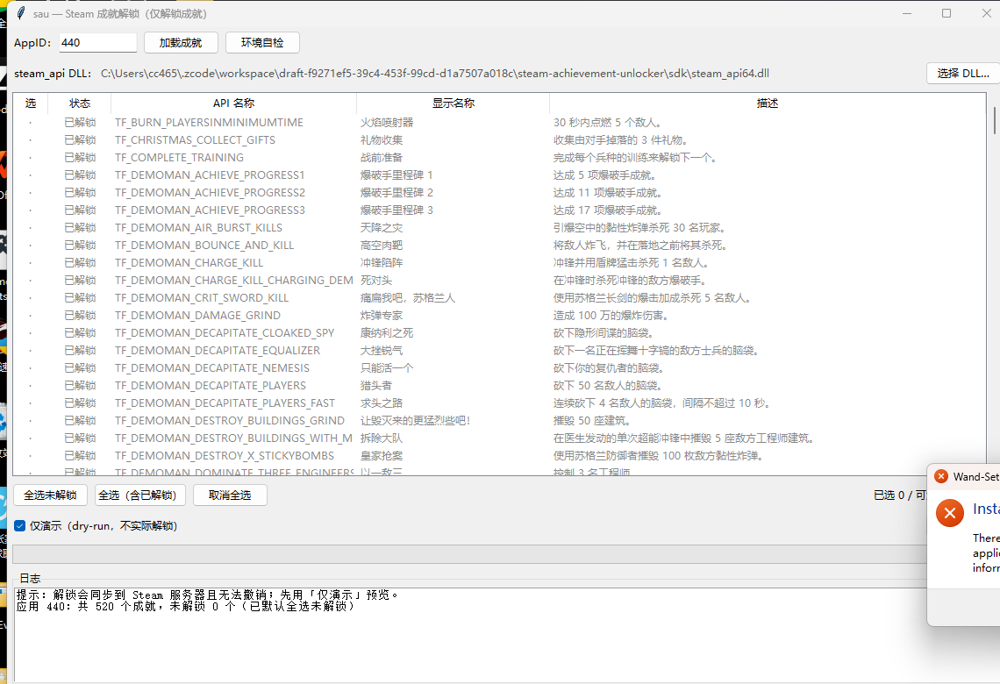

# sau — Steam Achievement Unlocker

Steam 成就解锁工具（命令行）。**仅提供"解锁成就"功能**，通过 Steamworks flat C API
与正在运行的 Steam 客户端通信，把成就解锁同步到 Steam 服务器（效果与 SAM /
SamRewritten 一致，以 Python + ctypes 实现）。

> **使用前必读**
> - 本工具操作的是**你自己的** Steam 账户，解锁成就会同步到服务器且**无法撤销**；
> - 篡改账户数据可能违反 Steam 订阅协议，风险自负；官方明确不建议在多人游戏中
>   使用此类工具（SamRewritten 原话："Using it in multiplayer games is highly discouraged"）；
> - 本工具**刻意不提供**锁定/清除/统计篡改功能，也不支持 VAC 或任何反作弊规避。

## 工作原理

1. 在进程工作目录写入 `steam_appid.txt`（Steamworks 官方开发机制），声明目标应用；
2. 加载 Steamworks 可再发行组件 `steam_api64.dll`，`SteamAPI_InitFlat()` 初始化
   （按 DLL 版本自动探测 InitFlat / InitEx / SteamInternal_SteamAPI_Init / Init / InitSafe）；
3. 通过访问器或 `SteamInternal_FindOrCreateUserInterface()` 逐版本探测拿到
   `ISteamUserStats`（当前 SDK 为 `STEAMUSERSTATS_INTERFACE_VERSION013`）；
4. `GetNumAchievements`/`GetAchievementName` 枚举成就 API 名称，
   `GetAchievement` 查询状态，`SetAchievement` 解锁；
5. `StoreStats()` 持久化并触发上传，随后跑 `RunCallbacks` 留出同步窗口；
6. `SteamAPI_Shutdown()` 释放。

> 注意：`SetAchievement` 只改内存状态，**必须 `StoreStats` 才会同步**——这是
> Steamworks 官方文档明确的行为，也是同类工具生效的关键。

## 环境要求

- Windows + 正在运行且已登录的 Steam 客户端；
- 你的账户**拥有**目标应用（未拥有时初始化会返回 FailedGeneric）；
- Python 3.9+（无任何第三方依赖）；Python 与 DLL **位数必须一致**（doctor 会预检）。

## 获取 steam_api64.dll

```bash
python scripts/fetch_sdk.py        # 从 Steamworks.NET 仓库下载并 sha256 校验
```

或手动下载后放到 `sdk/steam_api64.dll`，或任何游戏目录里的 `steam_api64.dll`
（需为带 flat C API 的 SDK 1.46+），用 `--dll` 指定。本仓库不直接分发该 DLL。

## 使用

### 方式一：单文件 exe（v0.4.2+，免 Python 环境）

`release/sau_gui/` 目录：双击 `sau_gui.exe` 即可（保持它与 `sdk\` 文件夹在同一
相对位置；同机使用时缓存已就绪）。exe 同时支持完整命令行（详见下方），
启动失败看同目录 `sau_crash.log`。

### 方式二：源码运行

全局参数（`--dll`、`--names-json`）必须写在**子命令之前**：

```bash
python -m sau doctor                          # 环境自检
python -m sau list 440                        # 列出成就（含 API 名称与已解锁状态）
python -m sau unlock 440 TF_COMPLETE_TRAINING # 解锁指定成就（API 名称区分大小写）
python -m sau unlock 440 NAME1 NAME2          # 批量解锁
python -m sau unlock 440 --all                # 解锁全部未获得成就（需确认，-y 跳过）
python -m sau unlock 440 --all --dry-run      # 演示将要解锁什么，不实际改动
```

### 游戏库（无需手输 AppID）

```bash
python -m sau games                           # 已安装的游戏（离线、瞬时）
python -m sau games --mode owned              # 账户拥有的全部应用（所有权扫描约 10 秒）
python -m sau games --mode owned --with-achievements   # 再逐个扫描成就数量（较慢，结果缓存）
python -m sau games --mode webapi --api-key KEY        # 官方接口（最准确，key 在 steamcommunity.com/dev/api-key 免费申请）
python -m sau unlock-library --dry-run --yes  # 批量演示：全库各游戏全部未获得成就
python -m sau unlock-library --yes            # 真实批量解锁（危险，逐游戏报告）
```

- `games` 的三种来源：`installed` 解析本地 appmanifest（离线）；`owned` 用
  ISteamApps::BIsSubscribedApp 全区间扫描 + GetAppList 名称（免 key）；`webapi`
  用 IPlayerService/GetOwnedGames（需 key）。
- 扫描结果缓存到 `sdk/library_cache.json`；`--refresh` 强制重扫。
- GUI 里点「加载游戏库」即可选游戏/批量解锁，全程不需要 AppID。

- 退出码：`0` 成功；`1` 运行错误（含存在未识别名称）；`2` 用法错误。
- `--settle N`：解锁后等待 Steam 同步的秒数（默认 2）。
- DLL 过旧无法枚举成就时，用 `--names-json` 提供
  `{"440": ["ACH_A", ...]}` 或 `["ACH_A", ...]` 格式的名称表。
- 真实环境自检脚本：`python scripts/steam_selftest.py 440`（只读列成就），
  追加 `--unlock NAME --confirm` 才会真实解锁。

## 图形界面

```bash
python -m sau gui      # 或直接双击 run_gui.bat（GBK+CRLF 编码，兼容 cmd 双击执行）
```

> run_gui.bat 启动后保留的黑色控制台窗口用于显示日志，可最小化，请勿直接关闭
> （关闭会连程序一起退出）。启动失败时完整报错会写入同目录 `gui_error.log`。



- 输入 AppID →「加载成就」：列出全部成就（API 名称 / 显示名称 / 描述 / 状态），
  **未解锁的默认全选**，单击行可切换勾选；
- 「加载游戏库」：自动枚举账户游戏（**无需手输 AppID**），**每个游戏带 Steam 真实
  名称与缩略图封面**（本地客户端缓存 + Steam CDN，离线可用），列表支持 Ctrl/Shift
  多选，提供**全选 / 反选 / 取消全选**按钮，有成就的游戏默认选中；
  「展示」可在**全部游戏 / 有成就系统的游戏**之间切换（2185 个应用一键过滤到
  118 个可解锁的）；「批量解锁选中的游戏」一次处理多个游戏（每游戏独立子进程）；
  截图见 `docs/gui_library_thumbs.png`；
- 「仅演示（dry-run）」默认勾选：只预览将要解锁的内容；取消勾选后点
  「解锁选中成就」/「批量解锁选中的游戏」会弹出确认框，确认后才写账户；
- 「环境自检」= 命令行 doctor，「选择 DLL…」切换 steam_api64.dll；
- Steam 调用全部在后台线程/子进程执行，界面不卡顿；进度条 + 日志实时反馈，
  解锁成功后自动刷新列表状态。

## 测试

```bash
python -m unittest discover -s tests -t . -v   # 55 个用例，无需 Steam
```

不依赖 Steam：业务层通过 `bindings_factory` 注入模拟客户端；PE 解析用系统
`kernel32.dll` 做真实样本；`sdk/steam_api64.dll` 存在时自动跑真实导出表核对。

## 项目结构

```
sau/            核心库：steamapi(ctypes 绑定) peinfo(PE 导出表) service(业务) library(游戏库) cli presenter gui
tests/          单元测试 + 模拟 Steam 客户端（101 用例）
scripts/        fetch_sdk.py（下载 DLL）、steam_selftest.py（真机自检）
docs/gui.png    界面截图
run_gui.bat     GUI 双击启动脚本
sdk/            steam_api64.dll、SDK 头文件与扫描缓存（脚本下载，不入库）
```

## 参考与致谢

- [gibbed/SteamAchievementManager](https://github.com/gibbed/SteamAchievementManager) — 鼻祖 SAM
- [PaulCombal/SamRewritten](https://github.com/PaulCombal/SamRewritten) — 现役实现（Rust），加载 Valve steamclient 库的思路
- [rlabrecque/Steamworks.NET](https://github.com/rlabrecque/Steamworks.NET) — 完整 flat 头与 redist DLL 来源
- [Detanup01/gbe_fork](https://github.com/Detanup01/gbe_fork) — SDK 头文件副本
- [ISteamUserStats 官方文档](https://partner.steamgames.com/doc/api/ISteamUserStats) — 行为语义（StoreStats 持久化、RequestCurrentStats 废弃等）

## 已知限制

- 不支持"锁定/清除"成就（按需求范围刻意裁剪）；
- 32 位 DLL 需配 32 位 Python（doctor 会提示）；
- 接口过旧的 DLL 无法枚举成就名（需 `--names-json`，GUI 暂未暴露该项）；
- 不处理需要服务器验证的特殊成就（如排行榜类）；解锁后 Steam 客户端 UI 的
  成就弹窗可能延迟数秒出现。

MIT License（本项目代码部分）。
